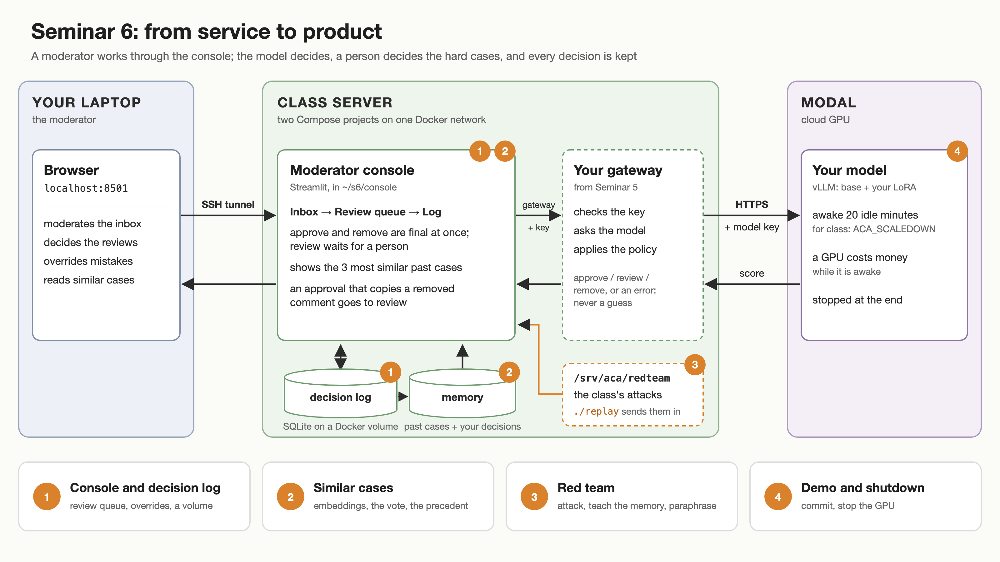

# Seminar 6 — Product

Your model answers an API. Today a moderator uses it: a console with an
inbox, a review queue for the comments the model is unsure about, and a log of
every decision. Then the class attacks everyone's service, and you see what a
memory of past cases can learn without retraining, and what it cannot.

```text
laptop → SSH tunnel → console on the class server → your Seminar 5 gateway → vLLM on Modal
                      inbox, review, decision log     approve / review / remove
                      similar past cases
```



The **console** is a second Compose project. It joins the Docker network of
your Seminar 5 gateway and calls it by name, `http://gateway:8000`; the
gateway's port stays private. Its **decision log** is an SQLite database on a
named Docker volume. Its **memory** is the labelled training comments plus
every comment decided in your log, searched with a small embedding model on
the CPU.

## Before you start

You need Seminar 5's gateway (missions 1 and 2) and your deployed model.

```bash
ssh ws
cd ~/course && git pull
cd ~/course/seminar_5
ACA_SCALEDOWN=1200 modal deploy serve.py
uv run client.py
cd ~/s5/gateway && docker compose up -d
docker compose ps
```

`ACA_SCALEDOWN=1200` keeps your GPU for 20 idle minutes instead of one: a
console is used with pauses, and a cold start takes longer than the gateway's
15-second deadline. That costs GPU time while you work. Mission 4 stops the
app; do not leave it deployed after class.

Today's work goes in `~/s6`. The console uses port `$MYPORT+4`.

The inbox holds Seminar 3's dev comments: real Reddit comments that
moderators had to deal with, including spam, insults and sexual content.

## Missions

| # | Mission | Mode | Minutes |
|---|---|---|---|
| 0 | The console and its decision log, on the Seminar 5 diagram | together | 5 |
| 1 | [Console and decision log](mission_1.md) | with agent | 35 |
| 2 | [Similar cases](mission_2.md) | with agent | 25 |
| – | Break | | 5 |
| 3 | [Red team](mission_3.md) | by hand | 30 |
| 4 | [Demo and shutdown](mission_4.md) | together | 20 |

Run `./check N` from this folder after each mission. Run `./catchup N` if you
are behind. A failed check prints what still needs fixing; finish it at home.

## What you keep

| Location | Contents |
|---|---|
| `~/s6/console/` | the console's source, Dockerfile and Compose file; commit these |
| `~/s6/console/.env` | your gateway key, port and network; private, not committed |
| `~/s6/console/data/` | memory (`cases.jsonl`, the training split) and inbox (`inbox.jsonl`, the dev split) |
| the `console_decisions` Docker volume | the decision log, `decisions.db` |
| `~/s6/redteam/` | your attacks, paraphrases and replay results |
| `~/s6/evaluate.json` | the vote's and the model's dev AUC |

## What we measured before class

The examples in the prompt hardly matter to your fine-tuned model. On the dev
split, AUC was 0.889 with each comment's own examples, 0.879 with the
gateway's fixed ones, 0.875 with the most similar retrieved ones, and 0.889
with none. Retrieval therefore goes to the human, not into the prompt. The
homework repeats this measurement with your own model.

**Homework:** [Does retrieval help the model?](homework/prompt_examples.md)
